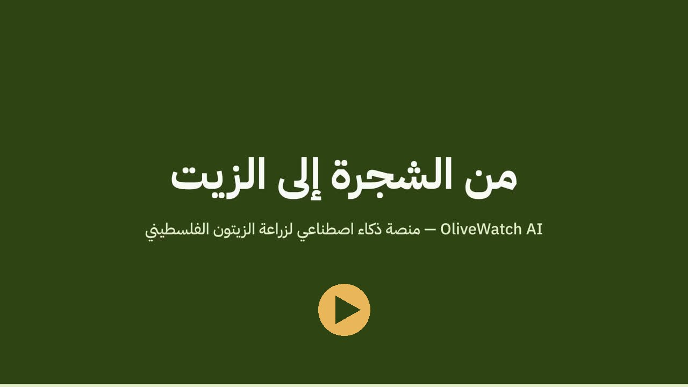

# OliveWatch AI · أوليف ووتش

**From Tree to Oil: protecting the value of every Palestinian olive harvest with AI.**
**من الشجرة إلى الزيت: نحمي قيمة كل حصاد زيتون فلسطيني بالذكاء الاصطناعي.**

| Part | Live link | For |
|---|---|---|
| Landing site | https://olivewatch-landing.vercel.app | Everyone: the idea and the product |
| Mill dashboard (platform) | https://olivewatch-platform.vercel.app | Olive mills: batches, suppliers, samples, traceability |
| Mobile app (farmer) | https://olivewatch-mobile.vercel.app | Farmers: leaf scan, climate, UV oil screening, advisor |

## Demo video

Two-minute walkthrough of the farmer app and the mill dashboard: [docs/media/olivewatch-demo.mp4](docs/media/olivewatch-demo.mp4)

---

## ملخص بالعربي

المزارع الفلسطيني ما بيتحكم بكمية حصاده: الوصول للأرض مش مضمون، والمناخ بيضغط على الشجر. لهيك كل كيلو بيوصل لازم ما يضيع.
OliveWatch AI منصة وحدة بتمشي مع الزيتون طول السنة:
- **قبل الموسم:** فحص صحة الشجرة بصورة الورقة، ومراقبة المناخ والأقمار الصناعية.
- **بالمعصرة:** فحص أولي لعينة الزيت تحت ضوء UV.
- **بعد العصر:** سجل تتبّع ورمز QR لكل دفعة.

كل النتائج **فحص أولي لدعم القرار**. هي مش تشخيص نهائي ولا شهادة مخبرية.

---

## 1. The problem

**The 2026 harvest is large on paper but not guaranteed.** The Palestinian Ministry of Agriculture estimates about **21,000 tonnes** of olive oil for 2026, against about **7,000 tonnes** in 2025. That estimate holds only if farmers can reach and harvest their groves. Between 1 September and 12 October 2026, OCHA documented **199 harvest-related attacks** and **more than 2,500 trees and saplings damaged**. The season supports an estimated **80,000–100,000 families**. These are preliminary figures [1].

**Climate adds pressure.** Research on Palestinian olive production finds that higher maximum temperatures significantly reduce olive and oil yields, more rainfall raises them, and the effect varies by region. Southern districts are particularly sensitive [3]. A separate study links climatic and bioclimatic variables to olive production in Jenin [4].

**Value is lost after the harvest too.** It is lost to disease noticed too late, delayed milling, oil that is rarely screened because lab tests are slow and costly, and the lack of any record that shows where a bottle came from.

> We cannot control every challenge facing Palestinian farmers. We can help them make better decisions with the land and harvest they are able to reach.

OliveWatch AI does not claim to increase the number of trees or to solve access restrictions. It aims to protect the value of the harvest that is actually obtained.

## 2. The solution

One platform that follows the olive all year round: **Farm → Tree health → Climate → Harvest → Mill → Oil screening → Traceability → Consumer.**

| Stage | What happens |
|---|---|
| Before the season | Leaf health checks, climate and NDVI alerts, a farm record, early action |
| Harvest | The harvest is recorded and linked to its farm |
| Mill | Batch intake and UV screening of the oil sample |
| After milling | QR code and traceability record for the product |

A healthier tree before the season gives a better chance of high-quality oil. We make no promise of a guaranteed yield increase.

### 2.1 Tree health: leaf disease check
- The farmer photographs or uploads an olive leaf.
- The result shows:
  - the most likely condition (for example peacock spot, *Spilocaea oleaginea*),
  - a confidence score,
  - the visible symptoms,
  - a next step such as "consult an agricultural specialist".
- Below **70% confidence**, the app asks for a new photo instead of guessing.
- The app gives no pesticide products or doses.
- Runs through the AI gateway on Google Gemini (free tier).

**Scientific basis:** image-based plant disease detection with deep learning. The **Oliver** dataset (3,354 annotated olive-leaf images across 5 classes) is our planned source for a dedicated olive model. Its licence is non-commercial research, so it is not used commercially [10].

### 2.2 Climate and satellite monitoring
- Each plot shows rainfall, maximum and minimum temperature, heatwaves and dry spells.
- **NDVI** (Normalized Difference Vegetation Index) from Sentinel-2 flags areas whose greenness is declining, so they can be inspected in the field. NDVI is an indicator that needs interpretation. It cannot diagnose disease or prove drought on its own.
- A **village ranking** by Climate Stress Index, with a map of villages around Nablus.
- A **climate scenario simulator**, for example +2 °C, −20% rain, +10 dry days.
- **Climate Stress Index (CSI):**
  `CSI = 100 × (0.4·min(ΔT/4, 1) + 0.4·min(−ΔP/40, 1) + 0.2·min(d/30, 1))`
  This is an illustrative index of our own, recomputed in code every time. It is a scenario tool, not a validated yield forecast.

**Scientific basis and data:** climate shocks and Palestinian olive yields [3]; environmental factors and olive production in Jenin [4]; CHIRPS rainfall [11]; NASA POWER temperature and climate [12]; Sentinel-2 surface reflectance for NDVI [13]. The demo screens use sample data, labelled "محاكاة / simulated".

### 2.3 UV oil screening
- At the mill, the oil sample is photographed under UV light.
- Olive oil contains chlorophylls, carotenoids and phenolic compounds that fluoresce. Different oils and adulteration patterns (for example blending with cheaper oils) give different fluorescence patterns.
- The analyzer checks photo quality first. A dark room is required; glare or a bright background means "retake".
- It then reads the colour signals of the liquid and returns one of:
  - within the reference pattern,
  - signs of aging,
  - strong oxidation pattern,
  - suspicion flagged,
  - retake the photo.
- Each result comes with a qualitative confidence level (low, medium or high).
- **Every non-reference result recommends laboratory verification.**
- The screening module is built on the **Zaytoun Vision** project, used with its authors' permission (see `zaytoun-backend/README.md`).

**Scientific basis:**
- Analytical methods for detecting olive oil adulteration [5].
- UV-Vis and fluorescence spectroscopy for authenticity and traceability [6].
- Combining analytical techniques to improve reliability [7].
- Fluorescence spectroscopy with machine learning for adulteration and geographical origin [8].
- Smartphone-based fluorescence imaging with AI for field-level screening [9].

**Limits:** these studies show the relevance of fluorescence screening; they do not prove our analyzer's performance. The analyzer has no measured accuracy on phone photos yet, and its confidence level is never "high" until the phone setup is calibrated. It is a preliminary screening aid, **not an accredited laboratory test**.

### 2.4 Digital traceability and mill dashboard
- Every farm has a record. Every harvest batch is linked to its farm.
- The mill records each batch, its sample result and its pressing details.
- The mill issues a digital seal and a QR code for each lot.
- The consumer sees the region, the mill, the season, the batch ID and the recorded screening result.
- **A QR code gives access to the record. It does not prove authenticity by itself.**

**Scientific basis:** authenticity, traceability and safety of extra virgin olive oil [6].

### 2.5 AI agricultural advisor
- A chat assistant explains results in simple Arabic, for example what the Climate Stress Index of the farm means and whether it may affect the olives.
- It answers from the farm's own data, adds no numbers that are not in that data, and recommends a specialist when needed.
- Responses carry the chip **"Gemini · فحص أولي / Preliminary"**.

## 3. What we built

| Component | Folder | Stack |
|---|---|---|
| Farmer mobile app, Arabic RTL with an English toggle | `mobile/` | Expo SDK 58, Expo Router, React Native Web |
| Mill and farmer web dashboard | `platform/` | Vite, React, TypeScript, Leaflet |
| Landing site | `landing/` | Vite, React, TypeScript |
| AI gateway, the only service that talks to Gemini; settings per feature, confidence floors | `gateway/` | Node, TypeScript |
| UV screening backend | `zaytoun-backend/` | Python, FastAPI |
| Database seed and checks | `firebase/` | Firebase Realtime Database |

**Honesty rules in the product:**
- Every value that is not real carries a chip: "حقيقية / real", "تجريبية / sample" or "محاكاة / simulated".
- Oil screening below 60% confidence names no class and asks for a lab check.
- The leaf check gives no treatment doses.
- The mobile screens follow the original design, and some of their copy (seals, grades, lab values) is placeholder text.

## 4. Business model

Revenue streams. All prices are **assumptions to validate**, not market prices.

| Stream | Assumption |
|---|---|
| Farmer subscription | Free and Pro plans, Pro at $3–7 per month |
| Mill SaaS subscription | $30–100 per month, depending on size |
| Pay per analysis | Leaf scans, UV screenings, detailed reports |
| QR and traceability services | For mills and brands |
| Annual institutional contracts | Cooperatives, agricultural organizations, development bodies |
| Aggregated analytics (later) | Anonymized and with permission; no identifiable farm data is sold |

**Illustrative early scenario, not a forecast:** 100 Pro farmers × $5 + 10 mills × $50 + $200 in reports = **$1,200 per month**.

**Go to market:** start with mills and cooperatives as paying customers; farmers join through them; independent farmer subscriptions come later. Market size (TAM/SAM/SOM) will be calculated from official agricultural statistics and field interviews, not invented.

**Feasibility study:** the team visited an olive mill and a farm. Findings: [add the key finding here].

## 5. 90-day pilot plan

| Days | Phase | Work |
|---|---|---|
| 1–30 | Preparation | Pilot agreement with 2–3 mills and a cooperative; partner with an agricultural expert; collect local leaf images; host the platform |
| 31–60 | Operation | Onboard 10–20 farms in Nablus, Jenin and Hebron; leaf scans and climate monitoring; record harvest batches at the mills |
| 61–90 | Evaluation | Screen oil samples that have reference lab results; compare our screening with the lab; measure adoption and willingness to pay; decide on scaling |

**Success indicators:**
- number of users,
- number of batches and samples,
- agreement between screening and lab results,
- willingness to pay.

## 6. Limitations

- Demo data is sample data, and AI results are preliminary screening.
- The UV analyzer has not yet been validated on dark-room photos of real oil samples with lab references.
- Satellite and climate data have coarse spatial resolution and cannot describe individual trees.
- There is no login yet, and the database rules must be locked down before real use.
- If the AI gateway is not configured, AI features fall back to clearly labelled simulated answers.

## 7. Run locally

    # database (once)
    cd firebase && npm install && npm run seed && npm run check

    # AI gateway (without it the apps show labelled simulated answers)
    cd gateway && npm install && cp .env.example .env   # set GEMINI_API_KEY, then: npm run dev

    # UV backend
    cd zaytoun-backend && python -m venv .venv && .venv\Scripts\activate
    pip install -r requirements.txt && uvicorn main:app --port 8000

    # apps
    cd mobile   && npm install && npx expo start        # press w for web
    cd platform && npm install && npm run dev            # http://localhost:5174
    cd landing  && npm install && npm run dev            # http://localhost:5175

Environment variables:
- Mobile: `EXPO_PUBLIC_AI_URL` and `EXPO_PUBLIC_ZAYTOUN_API_URL`.
- Dashboard: `VITE_ZAYTOUN_API_URL`.

Never commit `.env` files or keys. More detail: `gateway/README.md`, `zaytoun-backend/README.md`, `docs/uv-screening.md`.

## 8. Team

- **Fathi Al-Heelo**: full-stack mobile developer (React Native and Expo)
- [Name]: [Role]
- [Name]: [Role]
- [Name]: [Role]

## 9. References

**Context**
1. OCHA. *Humanitarian Situation Report*, 15 October 2026. https://www.ochaopt.org/content/humanitarian-situation-report-15-october-2026
2. OCHA. *Humanitarian Situation Report*, 22 October 2026. https://www.ochaopt.org/content/humanitarian-situation-report-22-october-2026

**Climate**

3. Daas, Y., Hallaq, S., Kashiwagi, K., Ogawa, K. (2025). *Rising Temperatures, Falling Yields: The Effect of Climate Shocks on Olive Oil Production in Palestine.* Levy Economics Institute (working paper). https://www.levyinstitute.org/publications/rising-temperatures-falling-yields-the-effect-of-climate-shocks-on-olive-oil-production-in-palestine/
4. Ighbareyeh (2025). *Effects of Environmental Factors on Olive Production of Jenin in Palestine.* Scientific Reports. https://www.nature.com/articles/s41598-024-83296-5

**Oil quality and authenticity (UV and fluorescence)**

5. *Recent Advances in Analytical Detection of Olive Oil Adulteration* (2022). ACS Food Science & Technology. https://doi.org/10.1021/acsfoodscitech.1c00254
6. *Extra Virgin Olive Oil: A Comprehensive Review of Efforts to Ensure Its Authenticity, Traceability, and Safety* (2022). https://ift.onlinelibrary.wiley.com/doi/10.1111/1541-4337.12949
7. *Recent Methods in Detection of Olive Oil Adulteration: State-of-the-Art* (2024). https://doi.org/10.1016/j.jafr.2024.101123
8. *Laser-Induced Breakdown Spectroscopy vs. Fluorescence Spectroscopy for Olive Oil Authentication* (2025). https://doi.org/10.3390/foods14061045
9. *AI-assisted smartphone-based prompt fluorescence imaging for adulteration monitoring of extra virgin olive oil* (2026). https://pubmed.ncbi.nlm.nih.gov/42804948/

**Datasets and data sources**

10. Oliver Dataset: olive pest and disease detection (non-commercial research licence). https://oliver.emu.edu.tr/en
11. CHIRPS rainfall data. https://www.chc.ucsb.edu/data/chirps3
12. NASA POWER. https://power.larc.nasa.gov/docs/
13. Sentinel-2 Harmonized Surface Reflectance (Google Earth Engine). https://developers.google.com/earth-engine/datasets/catalog/COPERNICUS_S2_SR_HARMONIZED

**Software built on**
- Zaytoun Vision (UV screening backend), used with the authors' permission. https://github.com/Mutasem-mk4/zaytoun-vision
- Google Gemini API (leaf check, advisor, explanations).

---

*OliveWatch AI: Every tree matters. Every harvest counts. Every drop has value.*
*كل شجرة تهم. كل حصاد يُحسب. وكل قطرة لها قيمة.*
