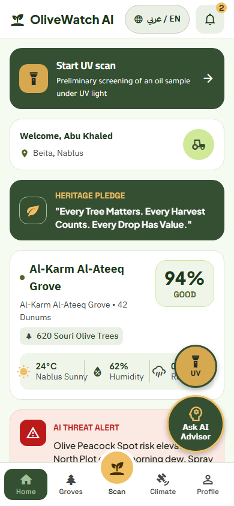
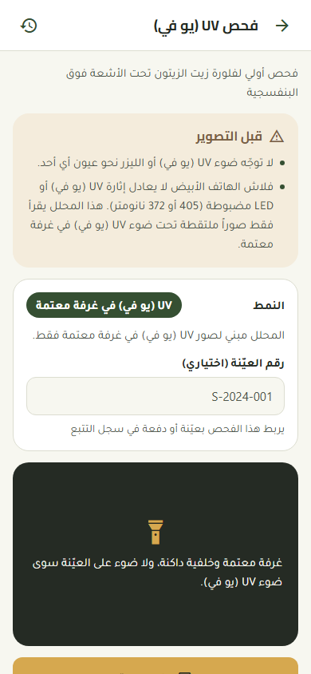
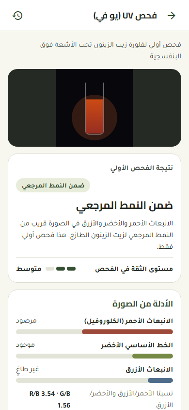
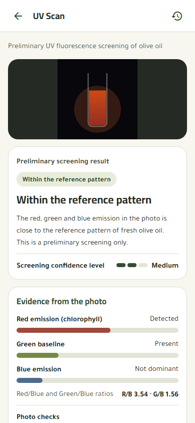
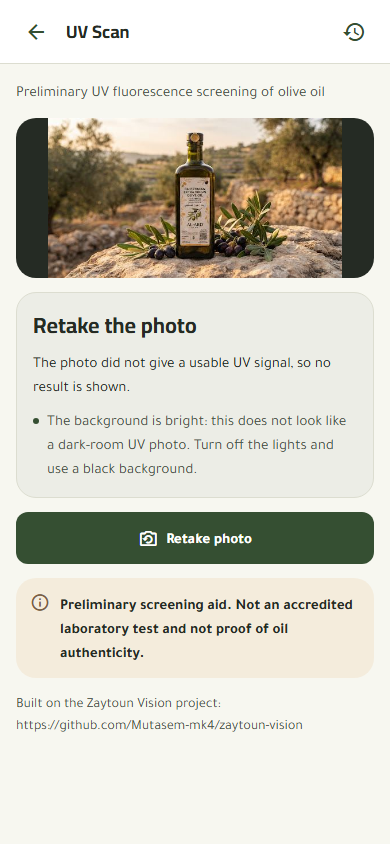
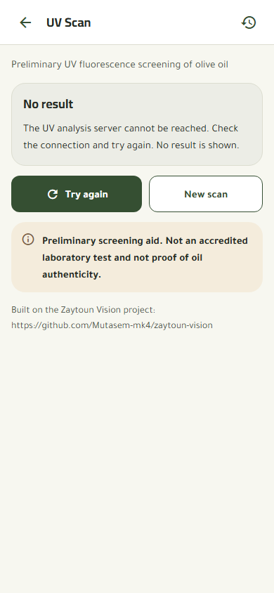
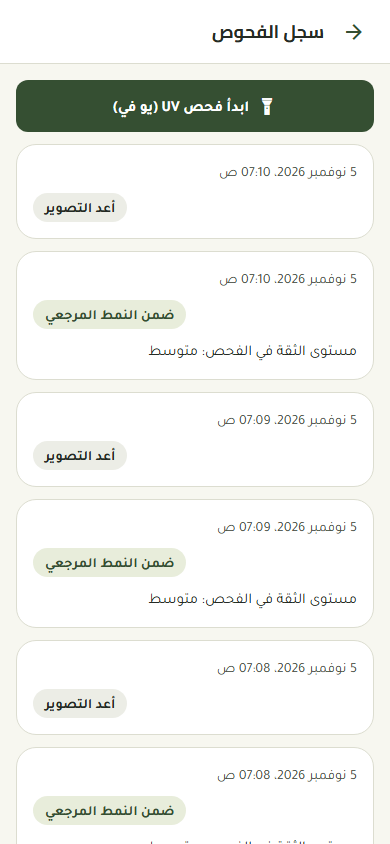
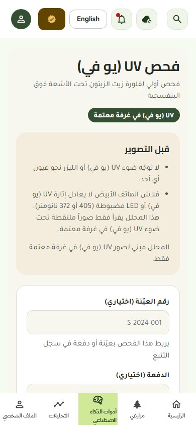
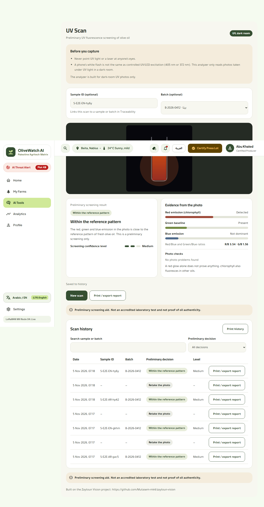
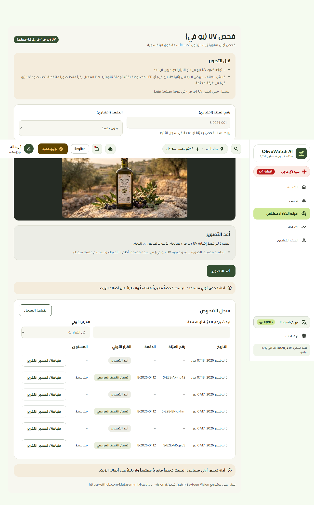

# UV screening (Zaytoun Vision): how to run it and the manual test run

Built on the Zaytoun Vision project: https://github.com/Mutasem-mk4/zaytoun-vision

> Preliminary screening aid. Not an accredited laboratory test and not proof of oil authenticity.

## Run locally

1. Backend (Python 3.11):

       cd zaytoun-backend
       python -m venv .venv
       .venv\Scripts\activate            # macOS / Linux: source .venv/bin/activate
       pip install -r requirements.txt
       uvicorn main:app --port 8000

   Check `http://127.0.0.1:8000/api/health` (answers `{"status":"ok",...}`) and the API docs at `/docs`.
   Use `127.0.0.1` rather than `localhost`: uvicorn listens on IPv4 only and some tools resolve `localhost` to IPv6.
2. Mobile app: in `mobile/.env.local` set `EXPO_PUBLIC_ZAYTOUN_API_URL=http://127.0.0.1:8000` (on a phone, use the
   computer's LAN address and start uvicorn with `--host 0.0.0.0`), then `cd mobile && npx expo start -c`.
3. Mill dashboard: in `platform/.env.local` set `VITE_ZAYTOUN_API_URL=http://127.0.0.1:8000`, then
   `cd platform && npm run dev` and open `http://localhost:5174/tools/uv`.
4. Unit tests of the client: `cd gateway && npm run test:uv` (11 tests). Backend tests:
   `cd zaytoun-backend && .venv\Scripts\python -m unittest test_uv_analysis`.

`ZAYTOUN_API_URL` is a public address, not a secret; the backend needs no keys. Never put Azure keys or `.env` files in
the repository.

## What the app shows

| Backend `category` | Shown as | Level |
|---|---|---|
| `fresh_evoo` | Within the reference pattern | low / medium / high |
| `real_but_aged` | Signs of aging flagged; laboratory verification recommended | " |
| `expired_olive_oil` | Strong oxidation pattern flagged; laboratory verification recommended | " |
| `fake_or_refined` | Suspicion flagged; laboratory verification recommended | " |
| `invalid_image`, `validForAnalysis=false`, or a bright background the backend "recovered" | Retake the photo (no result) | none |

The backend's verdict text, `purityScore`, `fakeProbability` and percentage confidence are never shown. The level is
"high" only when the confidence is at least 0.80 **and** the phone calibration is marked calibrated (it is not, in the
shipped `phone_calibration.json`), so today the level is at most "medium".

Scans are saved in the Realtime Database under `uvScans/{userId}/{scanId}`:
`{ at, mode: "uv", valid, decision, confidenceLevel, indicators, retake, sampleId?, batchId?, source, app }`.
No login exists yet: the mobile app files scans under the farm id (`farm-east`), the dashboard under the mill id.

## Manual run (5 Nov 2026, Chromium via Playwright, real backend, no stubbing except "backend down")

Test photos: `gateway/scripts/fixtures/uv-synthetic.png` (a drawn vial glowing red on a black background) and
`not-an-oil-uv.jpg` (a bottle photographed in daylight).

| Step | Result |
|---|---|
| Mobile, 390 px: Climate tab -> Home tab -> "Start UV scan" | `/uv` opens (2 taps); Home shows a top card and a floating UV button |
| Mobile: choose `uv-synthetic.png`, Analyze | `POST /api/analyze` 200; "Within the reference pattern", level Medium, evidence bars, the notice; "Saved to history" |
| Mobile: `not-an-oil-uv.jpg` | "Retake the photo" with the bright-background reason; no decision |
| Mobile: backend unreachable | "The UV analysis server cannot be reached ... No result is shown."; no decision |
| Mobile: history | both scans listed; old `/oil` link redirects to `/uv` |
| Dashboard: AI Tools -> mill tools list -> "UV Scan" | `/tools/uv` opens |
| Dashboard: sample ID + batch B-2026-0412 + `uv-synthetic.png` | result, level, notice, saved; Print opens a report with the sample ID and the notice |
| Dashboard: history search by sample ID / filter "Retake needed" | 1 row / 0 rows |
| Dashboard: batch page `/batches/B-2026-0412` | lists the scan as "UV Scan · Preliminary screening" |
| Dashboard: daylight photo / backend down | retake card / "cannot be reached", no result |
| Arabic and English, 390 px and 1280 px | RTL / LTR correct, no horizontal scroll, no page errors |

Screenshots (`docs/uv-screenshots/`):

| | |
|---|---|
|  |  |
|  |  |
|  |  |
|  |  |
|  |  |

In the full-page dashboard captures the sticky top bar appears in the middle of the page; that is a screenshot artefact.
The mobile result screenshots were taken before the ratio line got its `R/B` and `G/B` labels.

## Known limits

- The analyzer is a rule-based reading of RGB channels; it has no measured accuracy on phone photos. The drawn test
  vial gets "within the reference pattern": a drawing can pass, which shows how little the result proves.
- No real dark-room UV photo of an oil sample was tested; only the two fixtures above.
- No access control: the Realtime Database rules are open. Add Firebase Auth and restrict `uvScans/{uid}` before use.
